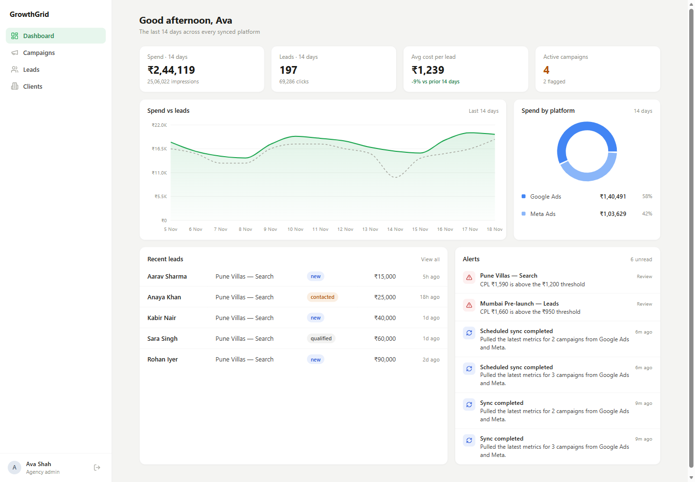
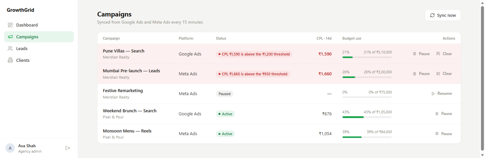
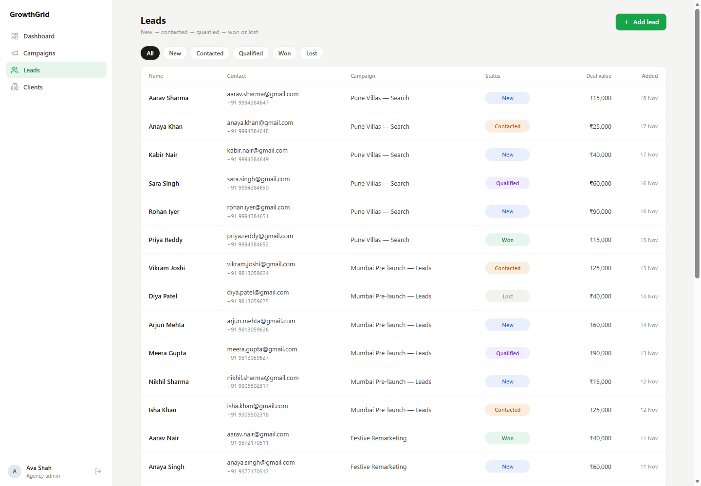
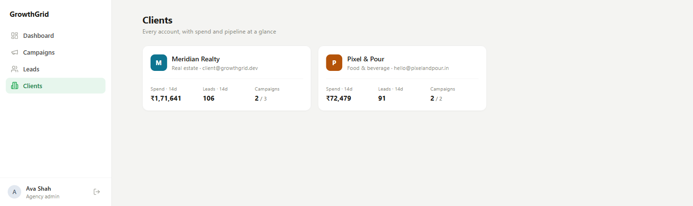
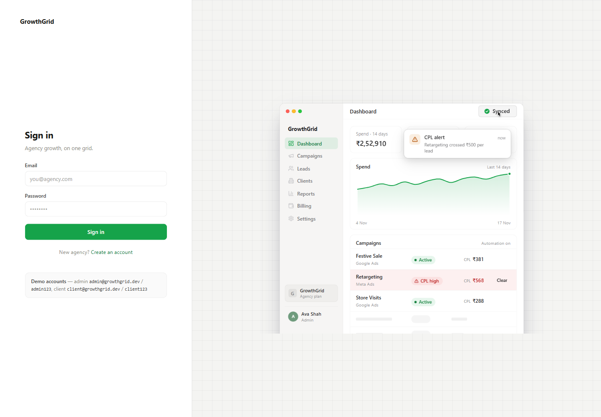

# GrowthGrid

A multi-tenant ad-ops dashboard for a digital marketing agency. It syncs
campaign metrics from Google Ads and Meta Ads, tracks every lead those
campaigns generate, and watches the numbers for you — flagging campaigns whose
cost per lead crosses a threshold and alerting when a budget is nearly spent.

The agency operates in India, so every amount in the product is INR.

- **Server** — Express + Mongoose API (`server/`), with a simulated ad-platform
  sync engine, automation rules and a 15-minute cron
- **Client** — React + Vite SPA (`client/`) with a dashboard, campaigns,
  leads and clients views

## Screenshots

Captured from the seeded demo workspace on a real sync, at 1440px wide.

**Dashboard** — spend, leads and cost per lead for the trailing 14 days, the
Google/Meta split, the latest leads and the alert feed:



**Campaigns** — trailing-14-day CPL against each campaign's threshold, lifetime
budget utilization, and pause/clear on any row that has been flagged:



**Leads** — every lead the platforms reported, newest first, filtered by
pipeline stage:



**Clients** — per-account spend, lead volume and campaign count, admin only:



**Sign in** — the auth page, with the scripted product demo that plays beside
the form:



## Quick start (zero setup)

Requires Node.js ≥ 18. No MongoDB install needed — the demo boots an embedded
in-memory MongoDB automatically.

```bash
cd server
npm install
npm run demo
```

This starts the API on **http://localhost:4000** and the client dev server on
**http://localhost:5173**, seeds the demo workspace on first boot (2 clients,
5 campaigns, 14 days of metrics, 26 leads) and keeps refreshing metrics every
15 minutes.

### Demo accounts

| Account | Email | Password | Sees |
| --- | --- | --- | --- |
| Agency admin | `admin@growthgrid.dev` | `admin123` | Everything: all clients, campaigns, leads, the Clients page |
| Client user | `client@growthgrid.dev` | `client123` | Only Meridian Realty's campaigns, leads and dashboard |

## Manual setup

Run the two packages separately:

```bash
# API → http://localhost:4000
cd server && npm install
npm run dev          # nodemon; prefers a local MongoDB, falls back to in-memory

# UI → http://localhost:5173 (proxies /api to the API)
cd client && npm install
npm run dev
```

To seed a real MongoDB instead of the in-memory one:

```bash
cd server
MONGODB_URI=mongodb://127.0.0.1:27017/growthgrid npm run seed
```

### Server environment variables

| Variable | Default | Purpose |
| --- | --- | --- |
| `PORT` | `4000` | API port |
| `MONGODB_URI` | `mongodb://127.0.0.1:27017/growthgrid` | Mongo connection string |
| `JWT_SECRET` | `growthgrid-dev-secret` | Token signing secret — set a real one outside demos |
| `CLIENT_ORIGIN` | `http://localhost:5173` | CORS origin |
| `SEED_DEMO_DATA` | `true` | Seed the demo workspace on first boot |
| `PREFER_MEMORY_DB` | `false` | Skip local Mongo entirely and always use the embedded in-memory server (set automatically by `npm run demo`) |

The client dev server reads `API_ORIGIN` (default `http://localhost:4000`) for
its `/api` proxy.

### Scripts

| Where | Command | What it does |
| --- | --- | --- |
| `server/` | `npm run demo` | One-command demo: seeded API + client together (`-- --api-only` to skip the UI) |
| `server/` | `npm run dev` / `npm start` | API with nodemon / plain node |
| `server/` | `npm run seed` | Seed a connected MongoDB, then exit |
| `server/` | `npm run test:api` | Boot the API against in-memory model stand-ins and run 46 contract checks |
| `client/` | `npm run dev` / `npm run build` | Vite dev server / production build |

## API

All routes except auth are behind `Authorization: Bearer <token>` from
`POST /api/auth/login`. Client-role users are automatically scoped to their own
client; admins see the whole agency.

| Endpoint | Description |
| --- | --- |
| `POST /api/auth/register` | Create a workspace: `{name, email, password, clientName}` → `{token, user}` (201) |
| `POST /api/auth/login` | `{email, password}` → `{token, user}` |
| `GET /api/auth/me` | Current user |
| `GET /api/dashboard/overview` | 14-day stats, daily spend/leads series, platform split, flagged campaigns, recent leads, notifications |
| `GET /api/campaigns` | Campaigns with 14-day CPL, lifetime budget utilization and flag state |
| `PATCH /api/campaigns/:id` | `{status: "active"\|"paused"}` (pausing clears its flag) or `{flagged: false}` |
| `POST /api/sync` | Pull the latest metrics now → `{synced, alerts}` |
| `GET /api/leads` | Leads newest-first (up to 300), with campaign name/platform |
| `POST /api/leads` | Add a manually captured lead |
| `PATCH /api/leads/:id` | Move a lead through `new → contacted → qualified → won/lost` |
| `GET /api/clients` | Admin only: per-client spend/leads/campaign rollups |

## How it fits together

```
client/                 React SPA (react-router, recharts, lucide)
  src/pages/            Dashboard, Campaigns, Leads, Clients, Login, Register
  src/demos/            Auth-page product demo (+ REHEARSAL.md notes)
server/
  src/models/           User, Client, Campaign, Lead, MetricSnapshot, Notification
  src/routes/           auth, dashboard, campaigns, leads, clients, sync
  src/services/
    adPlatforms.js      Simulated Google/Meta adapters (deterministic per
                        campaign-day, with seasonality, fatigue and bad days)
    sync.js             Sync engine, automation rules, demo seed
  scripts/              start-demo.js, seed-demo.js
  test/memory-harness/  In-memory Mongoose stand-ins + API contract checks
```

**Sync engine.** Every 15 minutes (and on demand via *Sync now*) the engine
pulls metrics from the platform adapters and upserts one `MetricSnapshot` per
campaign per day. Past days are immutable actuals — a sync never restates
history, so pausing a campaign today can't erase what it spent yesterday.
Leads reported by the platforms are materialized into the pipeline once per
campaign per day.

**Automation rules.** After each sync:

1. **CPL threshold** — an active campaign whose trailing-14-day CPL crosses its
   configured threshold is flagged with the reason, and a `cpl_alert`
   notification is raised (once, until the flag is cleared).
2. **Budget utilization** — when lifetime spend passes 90% of a campaign's
   total budget, a `budget_alert` notification is raised (at most one per day).

Notifications are scoped per client, so each tenant only sees its own alerts.

**Multi-tenancy.** Every `Lead`, `Campaign`, `MetricSnapshot` and
`Notification` belongs to a `Client`. Admin users see across tenants; users
with the `client` role are bound to one client and every query is filtered to
it (cross-tenant ids answer 404, and the Clients page is admin-only).

## Testing

```bash
cd server && npm run test:api
```

Boots the real Express app against in-memory model stand-ins (wired in with an
ESM loader, aggregations powered by mingo) and asserts every response shape the
client consumes — 46 checks covering auth, dashboard, campaigns, leads,
clients, the sync endpoint, automation flagging and tenant scoping. No MongoDB
required.

## The auth-page demo

The login/register pages embed a scripted product demo (`client/src/demos/SyncDemo.tsx`); its rehearsal record —
composition, film commands and gate results — lives in
`client/src/demos/REHEARSAL.md`, which is also the canonical API contract the
server implements.

## License

[MIT](LICENSE)
